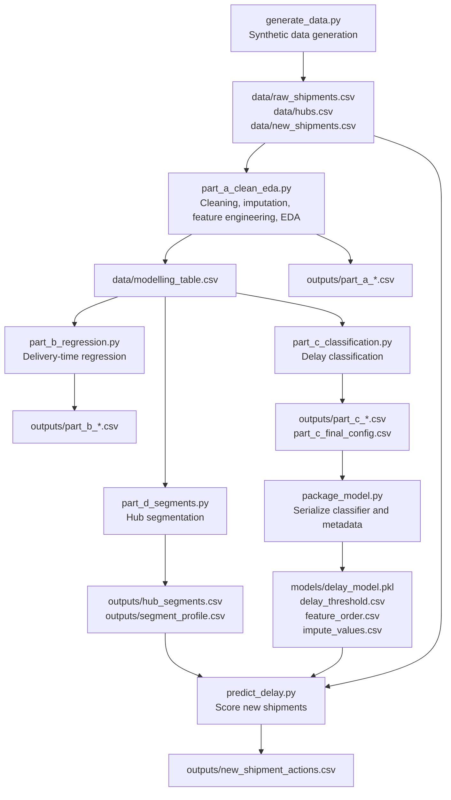
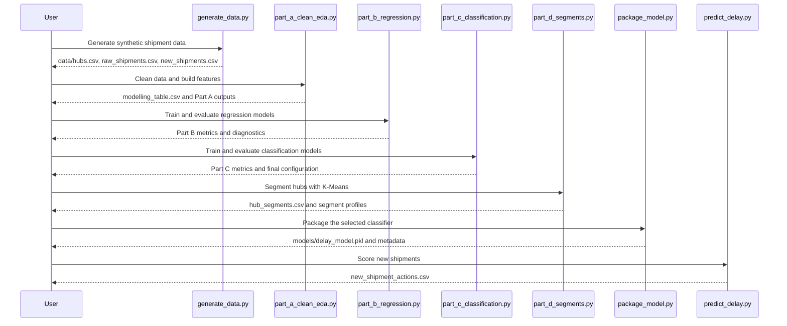

# Shipment Delay Intelligence Pipeline

## 1. Project Title

**Shipment Delay Intelligence Pipeline**

A Python machine learning project for shipment delay analysis, delivery-time regression, delay classification, and delivery-hub segmentation.

## 2. Project Author

**ANIKET RAJAK**

- **Project Author and Maintainer:** ANIKET RAJAK
- **Primary Language:** Python
- **Domain:** Machine Learning, Data Science, Shipment Analytics

The current project identity and maintenance metadata identify **ANIKET RAJAK** as the project author and maintainer. The repository's Git history is preserved; no historical commits are rewritten. The repository does not currently include a `LICENSE` file, and no license is invented or reassigned by this documentation.

## 3. Project Introduction

The Shipment Delay Intelligence Pipeline analyzes shipment records and produces three related outputs:

1. An estimate of delivery time in hours.
2. A probability that a shipment will be delayed.
3. A hub-level operating segment that helps prioritize operational attention.

The project is implemented entirely in Python and uses standard open-source data science libraries. The supplied dataset is synthetic and is generated by `generate_data.py`. It is **not real Delhivery data**, and this project is not affiliated with or endorsed by Delhivery. All monetary values are in Indian Rupees (INR).

## 4. Problem Statement

Shipment delays create customer dissatisfaction and make hub operations harder to plan. A useful delay-intelligence system should answer three practical questions:

- How long is a shipment likely to take?
- Which shipments are likely to be delayed?
- Which delivery hubs need the most operational attention?

The project addresses these questions with regression, classification, and clustering. Because the supplied data is synthetic, the results demonstrate a complete, reproducible machine learning workflow rather than real-world operational performance.

## 5. Project Overview

The pipeline covers the following stages:

| Stage | Script | Main purpose |
|---|---|---|
| Data generation | `generate_data.py` | Create synthetic hubs, historical shipments, and new shipments |
| Cleaning and EDA | `part_a_clean_eda.py` | Remove duplicates, normalize fields, impute values, engineer features, produce EDA outputs |
| Regression | `part_b_regression.py` | Predict `delivery_hours` and compare regression models |
| Classification | `part_c_classification.py` | Predict `is_delayed` and select a classifier, features, and threshold |
| Hub segmentation | `part_d_segments.py` | Cluster hubs with K-Means and compare segments with hub tiers |
| Model packaging | `package_model.py` | Serialize the selected classifier and supporting metadata |
| Prediction | `predict_delay.py` | Score new shipments and assign recommended actions |

## 6. Project Objectives

- Generate a reproducible synthetic shipment dataset with controlled data-quality issues.
- Clean and prepare shipment records without data leakage.
- Explore delay patterns by service type, hub tier, and distance band.
- Build and evaluate regression models for delivery time.
- Build and evaluate classification models for delay risk.
- Select a small, interpretable feature set with `SelectKBest`.
- Segment delivery hubs into operational groups using K-Means.
- Package the selected classifier and preprocessing metadata for repeatable scoring.
- Produce shipment-level actions for new shipments.
- Document results honestly, including limitations and uncertainty.

## 7. Technologies and Libraries

| Technology | Pinned version | Purpose |
|---|---|---|
| Python | 3.11 or 3.12 recommended | Runtime environment |
| pandas | 2.2.2 | Data loading, cleaning, aggregation, CSV output |
| numpy | 1.26.4 | Numerical operations and random data generation |
| scikit-learn | 1.6.1 | Regression, classification, feature selection, clustering, metrics, splitting |
| scipy | 1.13.1 | Pairwise distances for clustering separation checks |
| joblib | 1.4.2 | Model serialization and reload verification |

The saved model in `models/delay_model.pkl` was built with scikit-learn 1.6.1. Using a different scikit-learn version may produce an `InconsistentVersionWarning`; repackage the model with `python package_model.py` if the environment differs.

## 8. Project Directory Structure

```text
shipment-_delay_capstone/
├── .gitignore
├── README.md
├── CHANGELOG.md
├── requirements.txt
├── generate_data.py
├── part_a_clean_eda.py
├── part_b_regression.py
├── part_c_classification.py
├── part_d_segments.py
├── package_model.py
├── predict_delay.py
├── src/
│   └── shipment_prep.py
├── data/
│   ├── hubs.csv
│   ├── raw_shipments.csv
│   ├── modelling_table.csv
│   └── new_shipments.csv
├── models/
│   ├── delay_model.pkl
│   ├── delay_threshold.csv
│   ├── feature_order.csv
│   └── impute_values.csv
└── outputs/
    ├── hub_profile.csv
    ├── hub_segments.csv
    ├── new_shipment_actions.csv
    ├── part_a_checks.csv
    ├── part_a_correlations.csv
    ├── part_a_delay_by_group.csv
    ├── part_b_checks.csv
    ├── part_b_cv.csv
    ├── part_b_gb_learning_rate.csv
    ├── part_b_metrics.csv
    ├── part_b_tree_depth.csv
    ├── part_c_feature_scores.csv
    ├── part_c_final_config.csv
    ├── part_c_final_test.csv
    ├── part_c_models.csv
    ├── part_c_selectk.csv
    ├── part_c_thresholds.csv
    ├── part_c_tuning.csv
    ├── part_d_reload_check.csv
    ├── part_d_separation.csv
    ├── segment_profile.csv
    └── tier_vs_segment_mismatch.csv
```

## 9. System Architecture



## 10. Complete Project Workflow



The detailed workflow is:

1. `generate_data.py` creates 24 hubs, 1,200 clean historical shipments plus 24 duplicate rows, and 48 new shipments.
2. `part_a_clean_eda.py` removes duplicates, normalizes text fields, parses currency values, handles invalid weights, imputes missing values, merges hub attributes, creates the delay target, and writes EDA artifacts.
3. `part_b_regression.py` uses a fixed 70/15/15 split to compare regression models and evaluates the validation winner once on the test set.
4. `part_c_classification.py` uses stratified splits to compare classifiers, select features, tune a Random Forest, choose a threshold, and evaluate the test set once.
5. `part_d_segments.py` profiles each hub, compares K-Means solutions for K=2–5, fits K=3, and names the segments.
6. `package_model.py` rebuilds the selected classifier from `part_c_final_config.csv`, saves it with joblib, and checks that the reloaded model produces identical probabilities.
7. `predict_delay.py` loads the packaged model and metadata, scores the 48 new shipments, maps hub segments, and assigns recommended actions.

## 11. Dataset Description

All data is synthetic and generated with fixed random seeds.

| File | Rows | Description |
|---|---:|---|
| `data/hubs.csv` | 24 | Hub reference table |
| `data/raw_shipments.csv` | 1,224 | Messy historical shipment export including 24 exact duplicates |
| `data/modelling_table.csv` | 1,200 | Cleaned and feature-engineered historical shipments with the delay target |
| `data/new_shipments.csv` | 48 | Unlabelled shipments for scoring |

### `hubs.csv` columns

| Column | Meaning |
|---|---|
| `hub_id` | Hub identifier such as `HUB01` |
| `hub_city` | City name |
| `region` | Geographic region |
| `hub_tier` | Supplied hub category (1, 2, or 3) |
| `hub_daily_capacity` | Daily handling capacity |

### `raw_shipments.csv` columns

| Column | Meaning |
|---|---|
| `shipment_id` | Shipment identifier |
| `hub_id` | Dispatch hub |
| `service_type` | Express, Standard, or Economy; raw data contains inconsistent capitalization and spacing |
| `payment_mode` | Prepaid or COD |
| `parcel_weight_kg` | Parcel weight in kilograms; contains missing values and a sentinel value of 999 |
| `distance_km` | Lane distance in kilometres |
| `declared_value` | Declared value as text with the rupee symbol and commas |
| `n_stops` | Number of stops on the rider route |
| `rain_flag` | Rain indicator |
| `sale_event_flag` | Sale-event indicator |
| `dispatch_time` | Dispatch timestamp |
| `label_print_batch` | Noisy operational identifier |
| `scanner_build_no` | Noisy operational identifier |
| `tape_roll_no` | Noisy operational identifier |
| `sticker_serial_mod` | Noisy operational identifier |
| `shelf_slot_no` | Noisy operational identifier |
| `delivery_hours` | Actual delivery time in hours (target; not present in `new_shipments.csv`) |

The five noisy operational identifiers are intentionally included to test whether the modelling workflow can tolerate irrelevant columns.

## 12. Data Cleaning and Preprocessing

The shared logic lives in `src/shipment_prep.py`.

- **Exact duplicate removal:** 24 duplicate rows were removed, reducing 1,224 raw rows to 1,200 unique historical shipments.
- **Service-type normalization:** values are stripped and title-cased, reducing 12 raw spellings to 3 valid service types.
- **Payment mode:** missing values are filled with `Unknown` before creating the `is_cod` feature.
- **Currency parsing:** the rupee symbol and thousands separators are removed, and `declared_value` is converted to the numeric `declared_value_inr`.
- **Invalid weight handling:** parcel weights greater than 100 kg are treated as missing; 5 sentinel rows were found.
- **Missing-value counts before imputation:** distance 36, parcel weight 24, declared value 12, payment mode 18.
- **Median imputation:** training-time medians are used for `distance_km` (314.95), `parcel_weight_kg` (1.83), and `declared_value_inr` (1121.50). The same values are saved in `models/impute_values.csv` and reused for new shipments.
- **Hub merge:** hub city, region, tier, and daily capacity are attached with a validated many-to-one merge.
- **Feature engineering:** promised hours by service type, `is_cod`, `is_weekend`, `dispatch_hour`, and `log_declared_value`.
- **Target definition:** `is_delayed = 1` when `delivery_hours > promised_hours`; otherwise 0.

Promised-hour assumptions:

| Service type | Promised hours |
|---|---:|
| Express | 36 |
| Standard | 60 |
| Economy | 96 |

After cleaning, the modelling table contains 1,200 rows and has no missing values in the 17 model features or the target.

## 13. Exploratory Data Analysis

### Overall delay rate

- Historical shipments after deduplication: **1,200**
- Delayed shipments: **278**
- Delay rate: **23.17%**

### Delay rate by service type

| Service type | Shipments | Delayed | Delay rate | Mean delivery hours |
|---|---:|---:|---:|---:|
| Economy | 315 | 27 | 8.57% | 82.09 |
| Express | 243 | 119 | 48.97% | 36.81 |
| Standard | 642 | 132 | 20.56% | 52.26 |

### Delay rate by hub tier

| Hub tier | Shipments | Delayed | Delay rate | Mean delivery hours |
|---|---:|---:|---:|---:|
| 1 | 400 | 16 | 4.00% | 48.57 |
| 2 | 400 | 86 | 21.50% | 58.82 |
| 3 | 400 | 176 | 44.00% | 63.49 |

### Delay rate by distance band

| Distance band (km) | Shipments | Delayed | Delay rate | Mean delivery hours |
|---|---:|---:|---:|---:|
| 0–200 | 274 | 6 | 2.19% | 46.76 |
| 201–400 | 563 | 77 | 13.68% | 55.97 |
| 401–600 | 275 | 120 | 43.64% | 64.27 |
| 601+ | 88 | 75 | 85.23% | 72.26 |

### Correlation highlights

The strongest correlations with the delay target in `outputs/part_a_correlations.csv` were:

| Feature | Correlation with `is_delayed` |
|---|---:|
| `distance_km` | 0.5455 |
| `hub_tier` | 0.3871 |
| `n_stops` | 0.3379 |
| `rain_flag` | 0.2447 |
| `sale_event_flag` | 0.2264 |

These are associations in synthetic data, not causal effects. The IQR rule identified 1 delivery-time outlier (IQR bounds approximately -0.71 to 116.52 hours).

## 14. Regression Model

**Goal:** predict `delivery_hours`.

**Features:** the 17 columns in `FEATURES` from `src/shipment_prep.py`.

**Split:** 70% training (840 rows), 15% validation (180 rows), 15% test (180 rows), using `random_state=42`.

**Models compared:**

- Mean baseline
- Linear Regression with `StandardScaler`
- Decision Tree Regressor (depth selected on validation RMSE)
- Random Forest Regressor (100 trees)
- Gradient Boosting Regressor (100 estimators, learning rate 0.1)

Scaling was fitted only on the training data. The validation set was used for model selection. The test set was evaluated once for the selected model.

### Validation results

| Model | MAE | MSE | RMSE | R² |
|---|---:|---:|---:|---:|
| Mean baseline | 15.7952 | 355.5204 | 18.8552 | -0.0212 |
| Linear Regression | 3.9222 | 23.9235 | 4.8912 | 0.9313 |
| Decision Tree | 5.0971 | 39.4338 | 6.2796 | 0.8867 |
| Random Forest | 4.2759 | 30.1671 | 5.4925 | 0.9133 |
| Gradient Boosting | 3.9155 | 24.1664 | 4.9159 | 0.9306 |

Linear Regression had the lowest validation RMSE and was selected.

### Held-out test result

| Model | Split | MAE | MSE | RMSE | R² |
|---|---|---:|---:|---:|---:|
| Linear Regression | Test | 3.5671 | 20.4624 | 4.5235 | 0.9493 |

### Cross-validation

Five-fold cross-validation on the combined training and validation rows gave:

| Model | Mean R² | Standard deviation |
|---|---:|---:|
| Linear Regression | 0.9261 | 0.0048 |
| Gradient Boosting | 0.9351 | 0.0044 |

Gradient Boosting had a slightly higher cross-validated R², but Linear Regression had the lower validation RMSE and was retained as the validation winner. The test set was not used for this choice.

## 15. Classification Model

**Goal:** predict `is_delayed`.

**Target definition:** a shipment is delayed when its actual delivery time exceeds the promised time for its service type.

**Split:** stratified 70/15/15 split with `random_state=42`.

- Training: 840 rows, 195 delayed
- Validation: 180 rows, 42 delayed
- Test: 180 rows, 41 delayed

### Candidate models on validation data

| Model | TN | FP | FN | TP | Accuracy | Precision | Recall | F1 |
|---|---:|---:|---:|---:|---:|---:|---:|---:|
| Blind all-on-time | 138 | 0 | 42 | 0 | 76.67% | 0.00% | 0.00% | 0.00% |
| Logistic Regression | 128 | 10 | 7 | 35 | 90.56% | 77.78% | 83.33% | 80.46% |
| Decision Tree (depth 6) | 128 | 10 | 12 | 30 | 87.78% | 75.00% | 71.43% | 73.17% |
| Random Forest (default) | 132 | 6 | 11 | 31 | 90.56% | 83.78% | 73.81% | 78.48% |

### Feature selection

`SelectKBest` with the ANOVA F-score (`f_classif`) was compared for k = 5, 7, 10, 12, and 17:

| k | Validation F1 |
|---:|---:|
| 5 | 0.6988 |
| 7 | 0.8471 |
| 10 | 0.8095 |
| 12 | 0.7949 |
| 17 | 0.7848 |

k = 7 was used for the final classifier. The seven selected features were:

- `distance_km`
- `n_stops`
- `rain_flag`
- `sale_event_flag`
- `hub_tier`
- `hub_daily_capacity`
- `promised_hours`

### Top univariate feature scores

| Feature | F-score | Rank | Random Forest importance |
|---|---:|---:|---:|
| `distance_km` | 389.2131 | 1 | 0.2655 |
| `hub_tier` | 155.3483 | 2 | 0.0437 |
| `hub_daily_capacity` | 144.1347 | 3 | 0.0784 |
| `n_stops` | 125.4798 | 4 | 0.0752 |
| `promised_hours` | 84.4177 | 5 | 0.0836 |
| `rain_flag` | 53.0321 | 6 | 0.0436 |
| `sale_event_flag` | 36.7281 | 7 | 0.0307 |

### Hyperparameter tuning

The default Random Forest with seven features achieved a validation F1 of **0.8471**. Grid search and randomized search both selected a shallower forest (`max_depth=6`, `min_samples_leaf=1`, `n_estimators=50`) but achieved a lower validation F1 of **0.7805**. The simpler default configuration was therefore retained.

### Threshold selection

The threshold was chosen on validation data by requiring recall of at least 0.80 and then selecting the highest qualifying threshold. The selected threshold was **0.50**.

| Threshold | Precision | Recall | F1 |
|---:|---:|---:|---:|
| 0.20 | 0.5909 | 0.9286 | 0.7222 |
| 0.30 | 0.6842 | 0.9286 | 0.7879 |
| 0.40 | 0.7451 | 0.9048 | 0.8172 |
| 0.50 | 0.8372 | 0.8571 | 0.8471 |
| 0.60 | 0.8611 | 0.7381 | 0.7949 |

### Held-out test result at threshold 0.50

| TN | FP | FN | TP | Accuracy | Precision | Recall | F1 |
|---:|---:|---:|---:|---:|---:|---:|---:|
| 125 | 14 | 11 | 30 | 86.11% | 68.18% | 73.17% | 70.59% |

On the test set, 30 of 41 delayed shipments were detected, while 11 were missed. Of 44 flagged shipments, 30 were delayed and 14 were not. The test set is small, so these values have meaningful uncertainty.

## 16. Hub Segmentation

**Goal:** group hubs by observed shipment behaviour.

**Hub profile features:** mean delivery hours, delay rate, mean distance, and mean stops per hub.

The profile is standardized and clustered with K-Means (`random_state=42`, `n_init=10`).

### Separation comparison

| K | Across/within distance ratio | Cluster sizes |
|---:|---:|---|
| 2 | 2.8940 | 15-9 |
| 3 | 5.3928 | 9-8-7 |
| 4 | 6.3047 | 8-7-5-4 |
| 5 | 6.8866 | 8-7-4-3-2 |

K = 4 and K = 5 produced higher separation ratios but also produced clusters with fewer than six hubs. K = 3 was selected for a practical balance between separation and cluster size.

### K = 3 segment profile

| Segment | Hubs | Mean delivery hours | Mean delay rate | Mean distance (km) | Mean stops |
|---|---:|---:|---:|---:|---:|
| Standard | 7 | 47.2396 | 2.57% | 188.9296 | 55.3686 |
| Watch | 8 | 56.8137 | 15.50% | 314.1762 | 70.7175 |
| Escalate | 9 | 64.6504 | 46.00% | 470.4757 | 84.3444 |

### Segment vs supplied tier mismatches

| Hub | Segment | City | Supplied tier |
|---|---|---|---:|
| HUB07 | Watch | Kolkata | 1 |
| HUB13 | Escalate | Nagpur | 2 |
| HUB15 | Escalate | Kochi | 2 |
| HUB22 | Watch | Dehradun | 3 |

Tier is the supplied hub category. Segment is derived from observed shipment patterns. A mismatch should prompt investigation, not automatic reclassification.

## 17. Model Evaluation and Performance

### Evaluation design

- Regression and classification use separate fixed splits with `random_state=42`.
- Classification splits are stratified by the delay target.
- Scaling is fitted on training rows only.
- The feature selector is fitted on training rows only for the final model.
- The test set is evaluated once for the selected configuration.
- Threshold selection uses validation data, not test data.
- Model packaging verifies that the reloaded model produces the same probabilities as the in-memory model.

### Combined performance summary

| Task | Selected model | Main metrics |
|---|---|---|
| Delivery-time regression | Linear Regression | Test MAE 3.5671 h; RMSE 4.5235 h; R² 0.9493 |
| Delay classification | SelectKBest (k=7) + Random Forest (100 trees) | Test accuracy 86.11%; precision 68.18%; recall 73.17%; F1 70.59% |
| Hub segmentation | K-Means (K=3) | 7 Standard, 8 Watch, 9 Escalate hubs |
| Model packaging | joblib pipeline reload | Maximum absolute probability difference: 0.0 |

### Metric meanings

- **MAE:** average absolute error in hours; lower is better.
- **RMSE:** square root of mean squared error; penalizes large errors more heavily.
- **R²:** proportion of target variance explained; higher is better.
- **Precision:** share of flagged shipments that were actually delayed.
- **Recall:** share of delayed shipments that were flagged.
- **F1:** harmonic mean of precision and recall.

## 18. Actual Project Results

| Result area | Verified result |
|---|---|
| Raw historical rows | 1,224 |
| Duplicate rows removed | 24 |
| Clean historical rows | 1,200 |
| Delayed historical shipments | 278 |
| Historical delay rate | 23.17% |
| Regression test MAE | 3.5671 hours |
| Regression test RMSE | 4.5235 hours |
| Regression test R² | 0.9493 |
| Classification test accuracy | 86.11% |
| Classification test precision | 68.18% |
| Classification test recall | 73.17% |
| Classification test F1 | 70.59% |
| Hub segments | 7 Standard, 8 Watch, 9 Escalate |
| New shipments scored | 48 |
| New shipments flagged | 8 |
| Recommended escalations | 6 |
| Recommended proactive calls | 2 |
| New shipments with no action | 40 |
| Model reload maximum probability difference | 0.0 |

The new-shipment actions are produced by the current rule:

- Flagged shipment in an Escalate hub → **Escalate to hub manager**
- Flagged shipment in any other segment → **Proactive customer call**
- Unflagged shipment → **No action**

## 19. Installation and Environment Setup

Python 3.11 or 3.12 is recommended for the pinned dependencies. The saved model was built with scikit-learn 1.6.1.

### Windows

```bash
python -m venv .venv
.venv\Scripts\activate
python -m pip install --upgrade pip
pip install -r requirements.txt
```

### Linux or macOS

```bash
python3 -m venv .venv
source .venv/bin/activate
python -m pip install --upgrade pip
pip install -r requirements.txt
```

If you use a different scikit-learn version, the saved model may emit an `InconsistentVersionWarning`. In that case, repackage the model after installing a consistent environment:

```bash
python package_model.py
```

## 20. Step-by-Step Execution

Run all commands from the project root directory. The scripts resolve data, model, and output paths relative to the repository.

```bash
# 1. Generate the supplied synthetic data
python generate_data.py

# 2. Clean data, engineer features, and run EDA
python part_a_clean_eda.py

# 3. Train and evaluate regression models
python part_b_regression.py

# 4. Train and evaluate classification models
python part_c_classification.py

# 5. Segment delivery hubs
python part_d_segments.py

# 6. Package the selected classifier and metadata
python package_model.py

# 7. Score new shipments
python predict_delay.py
```

`package_model.py` depends on the Part C configuration and the Part A modelling table. `predict_delay.py` depends on the packaged model and `outputs/hub_segments.csv`, so run the steps in the order shown.

## 21. Expected Outputs

After a complete run, the repository should contain:

### Data outputs

| File | Expected content |
|---|---|
| `data/hubs.csv` | 24 hub records |
| `data/raw_shipments.csv` | 1,224 synthetic historical rows |
| `data/modelling_table.csv` | 1,200 cleaned rows with features and target |
| `data/new_shipments.csv` | 48 unlabelled shipments |

### Model artifacts

| File | Expected content |
|---|---|
| `models/delay_model.pkl` | Serialized `SelectKBest` + Random Forest pipeline |
| `models/delay_threshold.csv` | Selected classification threshold (0.5) |
| `models/feature_order.csv` | Ordered list of the 17 model features |
| `models/impute_values.csv` | Median imputation values for new shipments |

### Analysis outputs

| File | Expected content |
|---|---|
| `outputs/part_a_checks.csv` | Data-quality and distribution checks |
| `outputs/part_a_delay_by_group.csv` | Delay rates by service type, hub tier, and distance band |
| `outputs/part_a_correlations.csv` | Numeric correlation matrix |
| `outputs/part_b_metrics.csv` | Regression validation and test metrics |
| `outputs/part_b_tree_depth.csv` | Decision-tree depth experiment |
| `outputs/part_b_gb_learning_rate.csv` | Gradient-boosting learning-rate experiment |
| `outputs/part_b_cv.csv` | Five-fold cross-validation results |
| `outputs/part_b_checks.csv` | Split sizes and scaling checks |
| `outputs/part_c_models.csv` | Validation metrics for candidate classifiers |
| `outputs/part_c_feature_scores.csv` | Univariate scores and Random Forest importances |
| `outputs/part_c_selectk.csv` | SelectKBest comparison |
| `outputs/part_c_tuning.csv` | Grid-search and randomized-search results |
| `outputs/part_c_thresholds.csv` | Threshold comparison |
| `outputs/part_c_final_test.csv` | Held-out classification test result |
| `outputs/part_c_final_config.csv` | Final classifier configuration |
| `outputs/hub_profile.csv` | Per-hub shipment profile |
| `outputs/part_d_separation.csv` | K-Means separation comparison |
| `outputs/hub_segments.csv` | Hub-to-segment assignments |
| `outputs/segment_profile.csv` | Segment-level profile |
| `outputs/tier_vs_segment_mismatch.csv` | Hubs whose segment differs from the supplied tier |
| `outputs/part_d_reload_check.csv` | Model reload verification |
| `outputs/new_shipment_actions.csv` | 48 scored shipments with recommended actions |

## 22. Operational Recommendations

- Review **Escalate** hubs first, especially where observed delay rates are high.
- Use **Watch** hubs for daily monitoring and targeted operational checks.
- Keep **Standard** hubs under routine monitoring; their risk is low in this dataset but not zero.
- Treat classification alerts as prioritization signals, not guarantees that a parcel will be delayed.
- At threshold 0.50, the test set produced precision of about 68% and recall of about 73%. Roughly seven of every ten alerts were actual delays, and roughly seven of every ten delayed shipments were detected.
- For the 48 supplied new shipments, 8 were flagged: 6 require escalation to a hub manager and 2 require a proactive customer call. The remaining 40 require no action under the current rule.
- Validate hub assignments and predictions with operational teams before making high-impact decisions.
- Monitor regression error, classification precision and recall, flagged rates, and input data quality after any real-world deployment.
- Retrain periodically if the underlying data distribution changes, and revalidate before use.

## 23. Project Limitations

- **Synthetic data:** the dataset is generated with fixed rules and random noise; it may not represent real logistics operations.
- **No real-world validation:** the results demonstrate the workflow, not production performance.
- **Small test set:** the classification test set contains only 41 delayed shipments; a few different predictions could materially change the metrics.
- **Single split:** the reported test metrics come from one fixed 70/15/15 split rather than repeated nested evaluation.
- **Feature-selection timing:** during hyperparameter tuning, `SelectKBest` is applied before cross-validation. This can make tuning scores slightly optimistic. The final test set remains untouched.
- **Threshold uncertainty:** the threshold was selected from one validation split and may not generalize.
- **Feature importance is not causation:** the correlation and importance tables describe associations in synthetic data.
- **Model version sensitivity:** the packaged model is tied to scikit-learn 1.6.1 and should be repackaged if dependency versions change.
- **Dataset-specific prediction guard:** `predict_delay.py` expects exactly 48 new shipments, matching the supplied `new_shipments.csv`. A different input file requires updating that check.
- **No automated test suite or CI:** verification is currently performed by running the pipeline and comparing outputs.
- **No license file:** the repository does not currently include a `LICENSE`; clarify licensing before redistribution.

## 24. Future Improvements

- Add automated unit and integration tests for preprocessing, feature order, model packaging, and prediction.
- Add continuous integration to run the pipeline on every change.
- Introduce `pyproject.toml` for dependency and tooling configuration.
- Use time-based validation instead of random splits for temporal shipment data.
- Use nested cross-validation for feature selection and hyperparameter tuning.
- Evaluate probability calibration for the delay classifier.
- Add input-schema validation and clearer handling of unknown hubs, service types, and invalid timestamps.
- Replace the fixed 48-shipment prediction guard with a configurable input contract.
- Add experiment tracking and model-version metadata.
- Add monitoring and retraining procedures for real-world data.
- Add a command-line interface or lightweight API for batch scoring.
- Integrate real shipment data through a governed and privacy-aware data pipeline.

## 25. Project Author Information

**ANIKET RAJAK**

- **Role:** Project Author and Maintainer
- **Domain:** Machine Learning, Data Science, Shipment Analytics
- **Primary Language:** Python
- **Project:** Shipment Delay Intelligence Pipeline

The current project identity and maintenance metadata consistently identify **ANIKET RAJAK** as the project author and maintainer. The repository's Git history is preserved, and no historical commits are rewritten. The repository does not currently include a `LICENSE` file, and no license is invented or reassigned here.
